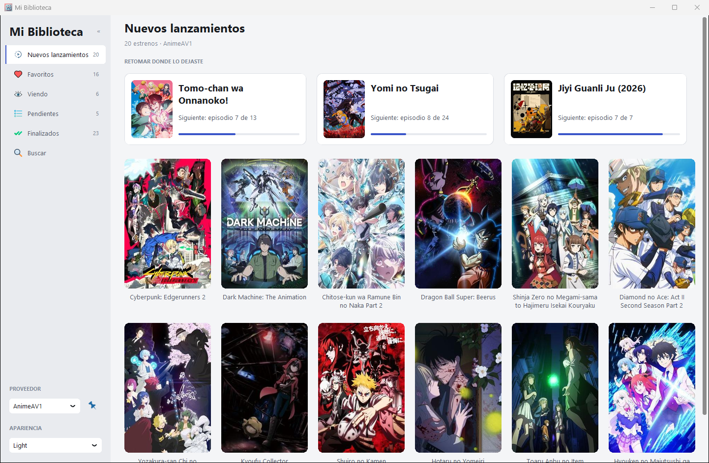
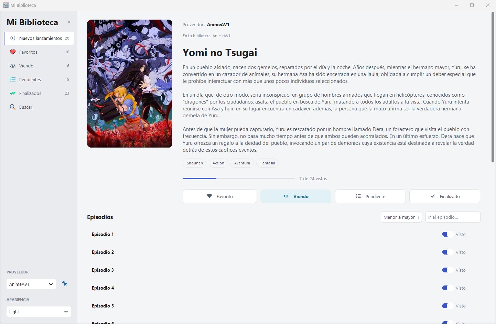
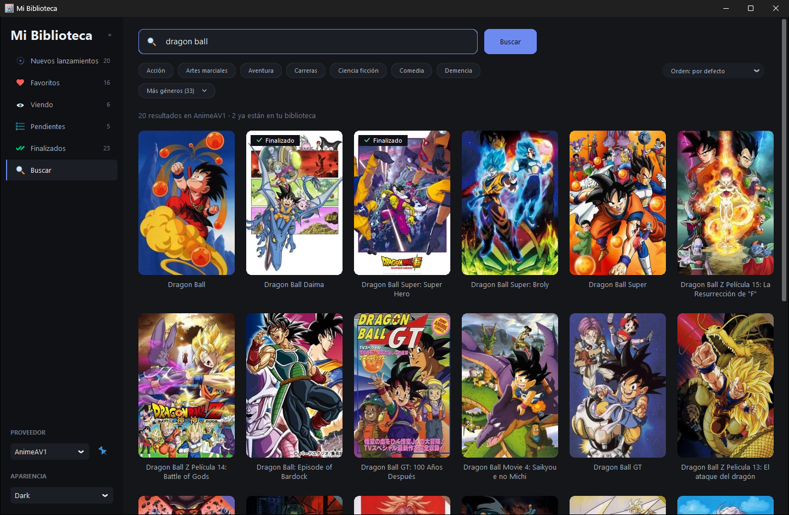
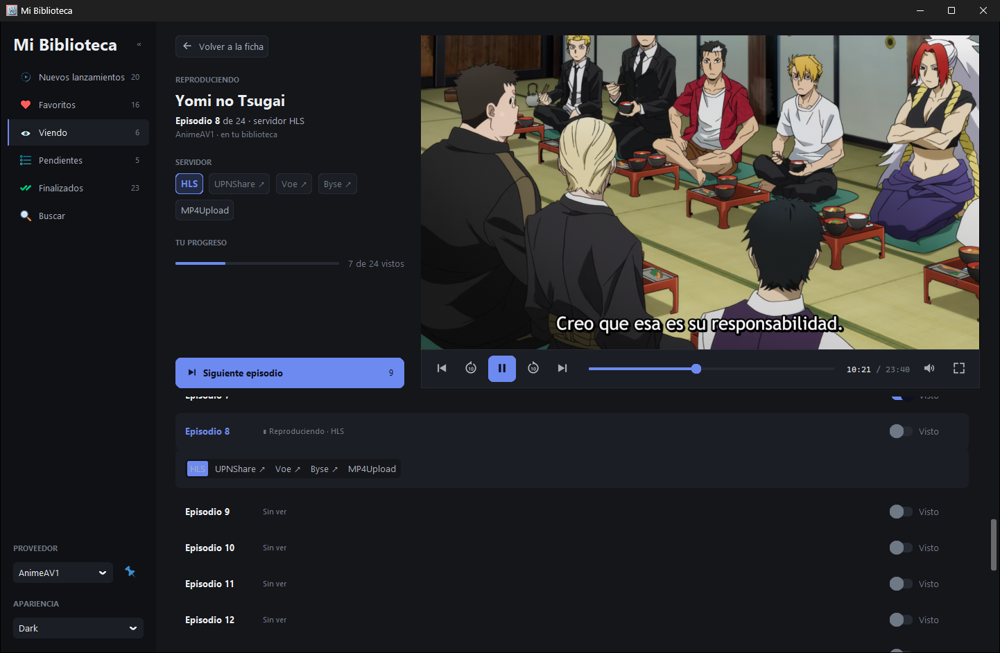

<div align="center">

# BibliotecaAnime

**Tu biblioteca de anime: tu colección vive solo en tu equipo; el catálogo llega de proveedores web públicos.**

[](#)
[](https://www.python.org/)
[](LICENSE)
[](#)
[](#)

[Características](#características-principales) • [Instalación](#instalación-y-despliegue) • [Estructura](#estructura-del-proyecto) • [Próximos pasos](#próximos-pasos) • [Licencia](#licencia)

</div>

---

## Sobre el Proyecto

**BibliotecaAnime** es una aplicación de escritorio nativa desarrollada en Python diseñada para gestionar tu catálogo de animes vistos, en seguimiento y pendientes.
A diferencia de plataformas como MyAnimeList o Anilist, este proyecto nace con una filosofía clara: **Privacidad, velocidad y control local**.

## Características Principales

- **Tu colección, solo en tu equipo:** La base de datos y las portadas se almacenan en local. Sin cuenta, sin registro y sin telemetría: la aplicación no tiene backend propio ni envía tus datos a ningún sitio.
- **Catálogo de varios proveedores:** Los datos de los animes (fichas, episodios y enlaces) se obtienen por *web scraping* de sitios públicos de anime, con selección de proveedor y sistema de reserva si uno falla. **Esta parte sí requiere conexión a internet.**
- **Rendimiento Nativo:** Una vez guardado un anime, navegar por tu biblioteca y buscar en ella es instantáneo y funciona sin conexión.
- **Reproductor integrado:** Los episodios se ven dentro de la propia ventana, con pantalla completa, salto al episodio siguiente y marcado automático como visto al terminar. Los servidores que todavía no se pueden reproducir dentro se abren en el navegador.
- **Temporadas y relacionados:** Cada ficha te lleva a la temporada anterior y a la siguiente, y reúne en una pestaña toda la franquicia —temporadas, películas, OVAs y especiales— con el estado de cada una en tu biblioteca. Una tercera pestaña, **Te puede interesar**, te sugiere animes de los mismos géneros que aún no has terminado.
- **Gestión Integral (CRUD):** Añade nuevos animes, marca los episodios vistos y organízalos por estados (*Favoritos, Viendo, Finalizados, Pendientes*). Retoma lo que estabas viendo desde la portada y puntúa tus favoritos.
- **Portable:** Posibilidad de compilar la aplicación en una carpeta autocontenida con su ejecutable (`.exe`) para llevar tu librería en un pendrive a cualquier parte.

---

## Capturas de Pantalla

|                       Nuevos lanzamientos                       |                       Ficha del anime                       |
|:---------------------------------------------------------------:|:-----------------------------------------------------------:|
|   |   |
|                           **Buscar**                            |                   **Reproductor integrado**                   |
|               |  |

---

## Tecnologías Utilizadas

- **Lenguaje:** [Python 3](https://www.python.org/)
- **Interfaz Gráfica:** *CustomTkinter*.
- **Base de Datos:** SQLite3 (Nativo en Python).
- **Manejo de Imágenes:** [Pillow (PIL)](https://python-pillow.org/)
- **Reproductor:** [mpv](https://mpv.io/) (`libmpv`) mediante [python-mpv](https://github.com/jaseg/python-mpv)
- **Empaquetado:** [PyInstaller](https://pyinstaller.org/)

---

## Instalación y Despliegue

### 1. Clonar el repositorio
```bash
git clone https://github.com/DavidEscri/BibliotecaAnime.git
```
```bash
cd BibliotecaAnime
```
### 2. Crear un Entorno Virtual (Ejemplo en Windows)
```bash
python -m venv venv
venv\Scripts\activate
```
### 3. Instalar Dependencias
```bash
pip install -r requirements.txt
```

### 4. Descargar libmpv (reproductor integrado)
Los episodios se reproducen dentro de la aplicación con [mpv](https://mpv.io/), que necesita la
biblioteca `libmpv-2.dll`. Pesa unos 120 MB, más de lo que GitHub admite en un fichero, así que
**no está en el repositorio** y hay que descargarla aparte:

<!-- libmpv:inicio · generado por tools/actualizar_libmpv.py -->
1. Descarga `mpv-dev-x86_64-20260923-git-6fd80b2003.7z` de
   [shinchiro/mpv-winbuild-cmake, versión 20260923](https://github.com/shinchiro/mpv-winbuild-cmake/releases/tag/20260923)
   (el build `x86_64` básico; el `-v3` exige un procesador con AVX2).
2. Extrae `libmpv-2.dll` en la carpeta `vendor/` de la raíz del proyecto (`vendor/libmpv-2.dll`).
3. Comprueba que es la versión validada: su SHA-256 debe ser
   `751131f81b5ce485d046ff08d1a44a93c5455be5135d53c0ab19c56780925ff0`.

O hazlo todo de una vez con `python tools/actualizar_libmpv.py --tag 20260923 --apply`,
que además la prueba y regenera sus avisos de licencia.
<!-- libmpv:fin -->

Sin la DLL la aplicación funciona igual, pero los episodios se abren en el navegador.

### 5. Ejecutar en modo desarrollo
```bash
python src/app.py
```

## Compilar el Ejecutable (.exe)
El proyecto incluye un archivo de configuración .spec (MiBibliotecaAnime.spec) preparado para generar un ejecutable independiente para Windows.
Antes de compilar, `vendor/libmpv-2.dll` tiene que estar en su sitio (paso 4): el ejecutable la
lleva dentro y la compilación se detiene si falta.
Para compilar la aplicación y no depender de la consola de Python, ejecuta:
```bash
pyinstaller MiBibliotecaAnime.spec
```
*El archivo ejecutable final se generará automáticamente dentro de la carpeta dist/MiBibliotecaAnime_v<VERSION>/*

## Estructura del Proyecto
```
MiBibliotecaAnime/
├── src/
│   ├── app.py                          # Punto de entrada principal
│   ├── APIs/
│   │   ├── common/
│   │   │   ├── models.py               # Estructuras de datos comunes a todos los proveedores
│   │   │   └── animeProviderMgr.py     # Gestor de proveedores de Anime
│   │   ├── animeav1/
│   │   │   └── animeav1.py             # Cliente web scraping de AnimeAV1
│   │   ├── jkanime/
│   │   │   └── jkanime.py              # Cliente web scraping de JKAnime
│   │   ├── animeflv/
│   │   │   └── animeflv.py             # Cliente web scraping de AnimeFLV
│   │   └── resolvers/                  # Del servidor del episodio al vídeo reproducible
│   │       ├── base.py                 # Contrato común de los resolutores
│   │       ├── registry.py             # Punto de entrada: elige el resolutor por dominio
│   │       └── zilla.py · jkplayer.py · mp4upload.py   # Un resolutor por hoster
│   ├── dataPersistence/
│   │   ├── animesPersistence.py        # Capa de acceso a datos de animes persistidos (SQLite)
│   │   └── userPersistence.py          # Capa de acceso a datos del usuario persistidos (SQLite)
│   ├── gui/
│   │   ├── main_window.py              # Ventana principal (CTk)
│   │   ├── anime_window.py             # Vista de detalle de un anime
│   │   ├── theme.py                    # Colores, tipografía y medidas de la interfaz
│   │   ├── components/                 # Piezas compartidas por las vistas
│   │   │   ├── sidebar.py              # Barra lateral plegable
│   │   │   ├── poster_grid.py          # Rejilla de pósters
│   │   │   ├── anime_row.py            # Fila de la cascada de «Viendo» y «Pendientes»
│   │   │   ├── video_player.py         # Reproductor integrado (mpv) y sus controles
│   │   │   └── ...                     # Paginador, estrellas, géneros, estados vacíos…
│   │   └── sidebarButtons/
│   │       ├── recentAnimes/           
│   │       │   └── recentAnimes.py     # Botón y vista: nuevos lanzamientos
│   │       ├── favouriteAnimes/        
│   │       │   └── favouriteAnimes.py  # Botón y vista: favoritos
│   │       ├── finishedAnimes/         
│   │       │   └── finishedAnimes.py   # Botón y vista: finalizados
│   │       ├── watchingAnimes/         
│   │       │   └── watchingAnimes.py   # Botón y vista: viendo
│   │       ├── pendingAnimes/          
│   │       │   └── pendingAnimes.py    # Botón y vista: pendientes
│   │       └── searchAnimes/           
│   │           └── searchAnimes.py     # Botón y vista: buscador
│   └── utils/
│       ├── utils.py                    # Helpers generales (imágenes, rutas, descarga)
│       ├── buttons/
│       │   └── utilsButtons.py         # Componentes de botones reutilizables
│       └── db/
│           └── sqlite.py               # Abstracción sobre sqlite3
├── resources/
│   ├── DB/
│   │   ├── DB_Animes.db                # Base de datos SQLite de Animes (generada en tiempo de ejecución)
│   │   └── DB_user.db                  # Base de datos SQLite de configuración del usuario (generada en tiempo de ejecución)
│   └── images/
│       ├── utils/                      # Iconos de la app (app_icon.ico, loading-image.gif, etc.)
│       ├── recent_animes/              # Posters en caché de animes recientes
│       ├── favourite/                  # Posters de animes favoritos
│       ├── finished/                   # Posters de animes finalizados
│       ├── watching/                   # Posters de animes en curso
│       ├── pending/                    # Posters de animes pendientes
│       └── search/                     # Posters temporales del buscador
├── tools/
│   └── actualizar_libmpv.py            # Descarga, prueba e instala libmpv y regenera sus avisos
├── vendor/
│   └── libmpv-2.dll                    # Biblioteca del reproductor (no está en el repositorio: paso 4)
├── MiBibliotecaAnime.spec              # Configuración de PyInstaller
├── requirements.txt                    # Librerías externas de python requeridas
├── LICENSE                             # Licencia del proyecto (GNU GPL v3)
├── LEEME.txt                           # Aviso de licencia y oferta de código fuente (se copia junto al .exe)
├── THIRD-PARTY-NOTICES.txt             # Avisos de licencia de las librerías de terceros (se copia junto al .exe)
└── README.md                           # Documentación del proyecto
```

## Próximos Pasos
 - Integración con mas servicios de streaming online de anime como MonosChinos2 o TioAnime.
 - Integración con servicios de visualización de manga online.
 - Alternar entre visualización de anime y manga.
 - Capacidad de identificar el capitulo del manga por el que continuar tras finalizar un anime.
 - Mostrar mangas relacionados que podrían gustar al usuario tras finalizar un anime o un manga.
 - Avisar de las temporadas nuevas de los animes que ya has terminado.
 - Reproducir dentro de la aplicación los servidores que hoy se abren en el navegador.

## Contribuciones
Siendo un proyecto personal, las sugerencias y mejoras son siempre bienvenidas. El proyecto sigue
Gitflow: `main` solo contiene versiones publicadas y el desarrollo se integra en `develop`. Si
deseas contribuir:
 1. Haz un Fork del proyecto.
 2. Crea una rama para tu función a partir de `develop` (git checkout -b feature/NuevaFuncion develop).
 3. Haz commit de tus cambios (git commit -m 'Añade NuevaFuncion').
 4. Haz push a la rama (git push origin feature/NuevaFuncion).
 5. Abre un Pull Request contra `develop`.

## Licencia

Copyright © 2024-2026 Jose David Escribano Orts

Este programa es software libre: puedes redistribuirlo y/o modificarlo bajo los términos de la
**GNU General Public License** publicada por la Free Software Foundation, ya sea la versión 3 de la
licencia o (a tu elección) cualquier versión posterior.

Este programa se distribuye con la esperanza de que sea útil, pero **SIN NINGUNA GARANTÍA**; ni
siquiera la garantía implícita de COMERCIABILIDAD o IDONEIDAD PARA UN PROPÓSITO PARTICULAR. Consulta
la GNU General Public License para más detalles.

Junto con este programa deberías haber recibido una copia de la GNU General Public License. Si no es
así, consulta [LICENSE](LICENSE) o <https://www.gnu.org/licenses/>.
